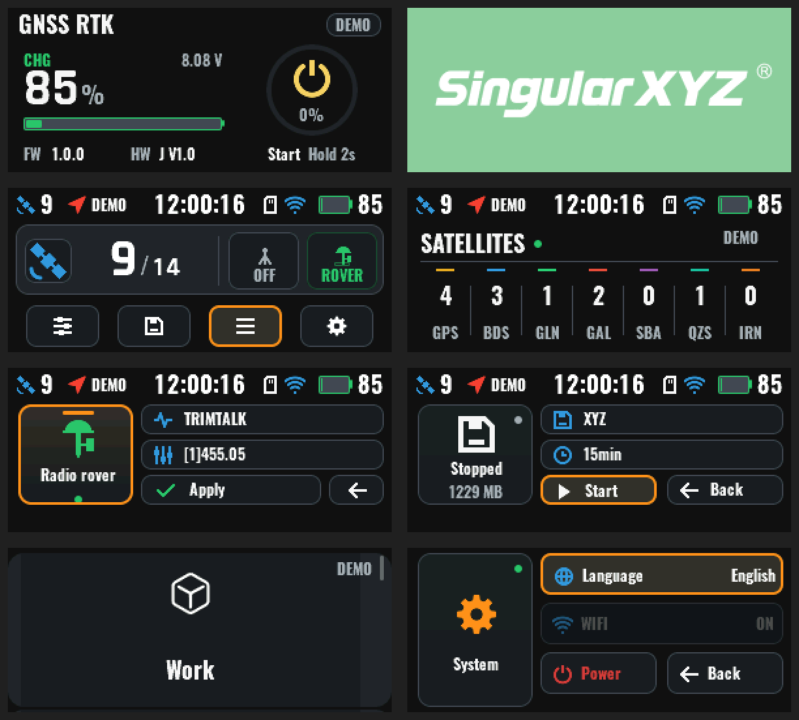

# GNSS_Panel

**基于 HC32F460xE 的嵌入式 UI 系统框架，集成原生外设驱动与 HAL、LVGL 9 界面库、X-TRACK 风格应用框架及跨平台模拟器。**


## 📖 项目简介

> 本项目是为小华半导体 (XHSC) HC32F460xE 系列开发的综合性嵌入式软件框架。应用层整体架构参照开源项目 [X-TRACK](https://github.com/FASTSHIFT/X-TRACK)（分层、节点化数据流、页面 MVP、应用组装），并在类型安全、资源占用和可测试性上做了改进，实现了从底层硬件驱动到高层 UI 交互的解耦设计。
> 核心意义：解决了国产 MCU 在高分 UI 场景下开发效率低、底层驱动与业务逻辑耦合严重的痛点。

同一份源码构建三类目标：

| 目标 | 说明 |
|---|---|
| HC32 固件 | `X1`（无屏，`MCU_LED`）、`X1Pro`（带屏，`MCU_PRO`）、`XBase`（带屏，`MCU_XBASE`） |
| PC 模拟器 | SDL2，`Board` 后端（编译 HC32 平台层，模拟 X1Pro/XBase）或 `Demo` 后端 |
| Linux 端口 | `Apps/Display` 屏幕应用（RK3506 显示端口、演示后端与主机测试）、`Apps/Survey` 独立逻辑应用 |

---

## ✨ 核心特性

> 🚀 **UI 引擎**：基于上游 LVGL v9.6.0（RGB565 原生渲染，发送缓冲中交换字节），只使用 v9 原生 API；针对 HC32F460 的 Cortex-M4F 与 96 KB LVGL 内存池做了页面预加载与按需创建。

> 🏗 **X-TRACK 风格应用框架**：`Frameworks/` 提供 PageManager（页面生命周期与切换动画）、DataBroker（同步发布/订阅数据节点与定时器）、DeviceManager（设备注册与 read/write/ioctl）、ResourceManager（静态资源表）。页面按 `UI/PageList.inc` 显式清单安装，并生成类型化的 `PageId`。

> 🔄 **节点化数据流**：`Service/DataProc` 中的 Power、Battery、GNSS、Clock、Work、Recorder、WiFi、Version、Init、Settings 等领域节点定时从 `Service/HAL` 细粒度设备拉取数据，只在值变化时发布；命令按语义校验，命令与状态使用不同类型。Button、PageNavi 节点负责两键手势与导航请求。

> 💻 **跨平台开发**：PC 端 SDL2 模拟器可直接运行 HC32 平台层代码，在电脑端预览和调试 UI 与业务逻辑，极大缩短开发周期。

> 🛠 **完善的驱动封装**：
> 基于 `Platform/Peripherals` 原生外设类（`GpioPin`、`I2cMaster`、`SpiMaster`）与板级实例（`board_peripherals`、`board_display`）的底层抽象。
> 硬件驱动支持：GPIO, UART, Flash, OTS, I2C Master/Slave (含面板帧协议), SPI + DMA, RM690A0 面板驱动 (`PanelRm690a0`), BQ40Z50 电量计与 MP2762A 充电芯片等。

> ⚡ **低功耗优化**：主循环内置 `__WFI()` 指令与事件驱动逻辑，平衡性能与功耗。

---

## 😄 实物演示

当前界面（Demo 后端模拟器渲染，294×126 原尺寸放大 2 倍）：Startup 待机、SystemLoading Logo、Dialplate 主页、StarMap 星图、WorkSettings、RecordConfig、SystemInfos、SystemDash。



## 📂 项目结构说明

> 项目采用分层架构，确保代码的可移植性和可维护性：

```
├── App               # 跨平台共享应用（HC32 带屏固件、模拟器、Linux 共用）
│   ├── Service       #   DataProc 领域节点、HAL 设备契约、i18n 多语言文本
│   ├── UI            #   各页面（Page/Model/View）、StatusBar、BatteryWarning、资源、AppFactory 与 PageList
│   ├── Utils         #   定点格式化、两键手势、日志、动画标签等通用工具
│   └── tests         #   不依赖 LVGL 的核心测试
├── Frameworks        # 跨平台基础框架（DataBroker、DeviceManager、PageManager、ResourceManager）
├── External/lvgl     # 上游 LVGL v9.6.0 源码（不含平台 lv_conf.h 与 porting）
├── Vendor            # 平台实现层
│   ├── HC32          #   HC32F460xE 固件（Platform、Libraries、Comm、Display、Products）
│   ├── Simulator     #   PC 端 SDL2 模拟器（SIM_BACKEND=Board|Demo，SIM_PRODUCT=X1Pro|XBase）
│   └── Linux         #   Apps/Display 屏幕应用、Apps/Survey 逻辑应用
├── cmake             # 工具链文件与公共编译选项（配合根目录 CMakePresets.json）
├── docs              # 架构、产品结构、构建与迁移文档
└── tests             # HC32 主机回归测试（协议、传输、电源、显示应用、各产品协议表、分层检查）
```

依赖方向：UI → Service/DataProc → Service/HAL（仅头文件契约）→ Frameworks；`Vendor/` 实现 HAL 设备并注册到 DeviceManager。`Vendor/HC32/Platform` 由三款产品共享，不依赖 LVGL 与 `App/`。分层规则由 `tests/check_layers.py` 检查。

## 🔨 构建

顶层按 `PLATFORM=HC32|Simulator|Linux`（默认 `HC32`）分发到 `Vendor/<平台>`。每次配置 HC32 只构建一个产品，`<product>` 为 `x1`、`x1pro` 或 `xbase`：

```bash
cmake --preset <product>-debug        # 或 <product>-release
cmake --build --preset <product>-debug
```

产物位于 `build/<preset>/`（`.elf`、`.map`）和 `build/<preset>/generated/`（`.hex`、`.bin`）。

OEM/白牌通过配置命令追加 `-DOEM=<name>` 选择，例如 `cmake --preset x1pro-release -DOEM=demo`（默认 `singularxyz`；也支持 `rgk`、`neutral`）；客户配置与已生成资源位于 `App/UI/Resource/oem/`，固件构建不运行 Python。

```bash
# PC 模拟器（HC32 Board 后端：X1Pro 或 XBase）
cmake --preset simulator-x1pro        # 或 simulator-xbase
cmake --build --preset simulator-x1pro
./build/simulator-x1pro/bin/main      # 输出在各自构建目录的 bin/，启动时打印按键说明

# PC 模拟器（Demo 后端，可选 --random-status [seed]）
cmake -S . -B build/sim-demo -DPLATFORM=Simulator -DSIM_BACKEND=Demo
cmake --build build/sim-demo
./build/sim-demo/bin/main --random-status 42

# Linux 端口主机构建与测试
cmake --preset linux-host && cmake --build --preset linux-host && ctest --test-dir build/linux-host --output-on-failure

# HC32 主机回归测试与共享核心测试
cmake -S tests -B build/host-tests && cmake --build build/host-tests && ctest --test-dir build/host-tests --output-on-failure
cmake -S App/tests -B build/app-core-tests && cmake --build build/app-core-tests && ctest --test-dir build/app-core-tests --output-on-failure

# 分层与状态归属检查（需先配置上述构建目录）
python3 tests/check_layers.py .
python3 tests/check_state_ownership.py .
```

更多说明：

- 产品差异的组织方式：[docs/product_structure.md](docs/product_structure.md)
- 构建分层与目标命名：[docs/build_architecture.md](docs/build_architecture.md)
- 应用架构与重构方案：[docs/app_architecture_review.md](docs/app_architecture_review.md)、[App/ARCHITECTURE.md](App/ARCHITECTURE.md)
- LVGL 9 迁移记录：[docs/lvgl9_migration.md](docs/lvgl9_migration.md)

## 🛠 技术深度 (Technical Stack)

> 在本项目中，我完成了以下关键技术任务：

> **硬件抽象层 (HAL) 适配**：将小华官方 DDL 库封装为 `Platform/Peripherals` 原生外设类（`GpioPin`、`I2cMaster`、`SpiMaster`）与共用 HAL 接口，通过 `HAL::HAL_Init()` 统一管理外设生命周期。

> **I2C 通信协议开发**：实现了 I2C 从机传输与面板帧协议（`Comm/`），用于 MCU 与主控之间的可靠数据交换。

> **UI 性能调优**：在 V2.1.0 版本中重构了框架，优化了 LVGL 的 flush_cb 绘制逻辑，提升了 UI 的帧率和响应速度。

> **去 Arduino 化与 LVGL 9 迁移**：移除 Arduino 兼容核心与 Adafruit 库，改用原生外设类；从 LVGL 8.3 升级到 9.6，并控制 HC32 的 RAM/flash 预算。

> **应用框架重构**：参照 X-TRACK 将单体应用拆分为领域数据节点、细粒度 HAL 设备与页面 MVP，节点 ID、命令和状态均类型化，页面导航由 `PageId` 驱动。

> **页面状态机设计**：在 `App_Update` 中实现非阻塞的异步任务处理，确保 UI 刷新与后台数据读取互不干扰。

## 📄 许可证

本项目自有代码以 [MIT 许可证](LICENSE) 发布。`External/` 与 `Vendor/HC32/Libraries/`、`Vendor/HC32/Platform/` 中的第三方组件（LVGL、XHSC DDL、CMSIS、SEGGER RTT、EasyLogger、MultiButton 等）保留各自的许可证。

## 致谢

> 感谢 [@FASTSHIFT](https://github.com/FASTSHIFT/X-TRACK) 贡献的参考设计：[页面生命周期管理](https://github.com/FASTSHIFT/X-TRACK/tree/main/Software/X-Track/USER/App/Utils/PageManager) 与 X-TRACK 应用架构。
